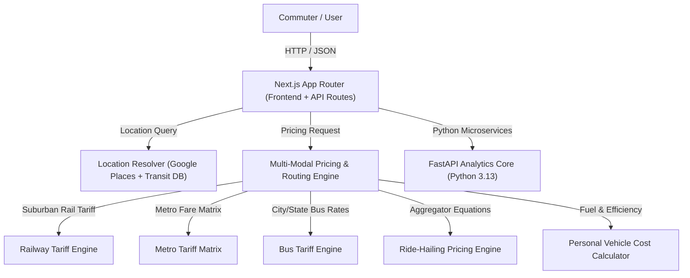

# Architecture & System Design — Route Sense

## Executive Summary

Route Sense is an intelligent public transport journey planning and mobility comparison platform engineered specifically for the Indian market. The architecture is decoupled into a high-performance Next.js 14 frontend layer and a modular FastAPI / Python analytical core, designed for serverless execution on Vercel and containerized server deployments.

---

## 1. System Layers

### 1.1 Presentation Layer (Frontend)
- **Framework**: Next.js 14 (App Router, Server Components & Client Components).
- **Styling**: Tailwind CSS for responsive light-theme interfaces.
- **Iconography**: Lucide React.
- **Mapping**: Leaflet / React-Leaflet for interactive corridor display.

### 1.2 API Gateway & Orchestration Layer
- **Location Autocomplete (`/api/v1/location/autocomplete`)**: Resolves user queries to verified geographic entities across India.
- **Route Planner (`/api/v1/planner/route`)**: Orchestrates distance calculation, route generation, fare evaluation, and option sorting.

### 1.3 Core Engines
- **Geospatial Engine**: Computes circuity-adjusted road and rail distance matrices using Haversine formulas and routing provider responses.
- **Pricing Engine (`src/lib/pricing/engine.ts`)**: Evaluates mode-specific pricing rules (Railway base slabs, Metro fare structures, Bus tariffs, Cab surge models, and Fuel running cost).

---

## 2. Data Flow Architecture

1. **User Query Input**: Commuter inputs origin (`Dadar Railway Station`) and destination (`CSMT`).
2. **Entity Resolution**: `resolveLocation()` searches Google Places API or fallback Indian Transit Database.
3. **Distance & Corridor Resolution**: System calculates straight-line and circuity-adjusted route distance ($1.30\times$ road circuity factor).
4. **Multi-Modal Fare Calculation**:
   - Suburban Rail: $\text{Base} + \text{Slab Tariff}$.
   - Metro Rail: Distance-band matrix tariff (₹10 - ₹60).
   - Bus: City stage rate / State express rate per km.
   - Aggregator Cab: $\text{Base Fare} + (\text{Distance} \times \text{Per KM Rate}) \times \text{Surge Factor}$.
   - Personal Vehicle: $(\text{Distance} / \text{Efficiency}) \times \text{Fuel Price} + \text{Tolls}$.
5. **Normalised Response**: Standardized JSON payload containing array of `NormalizedJourneyOption` objects with explicit freshness tags.

---

## 3. Deployment Topology

- **Vercel**: Edge and Node.js serverless functions powering Next.js application routes.
- **FastAPI / Python Service**: Renders analytics, PDF reports, and Scikit-Learn prediction models.
