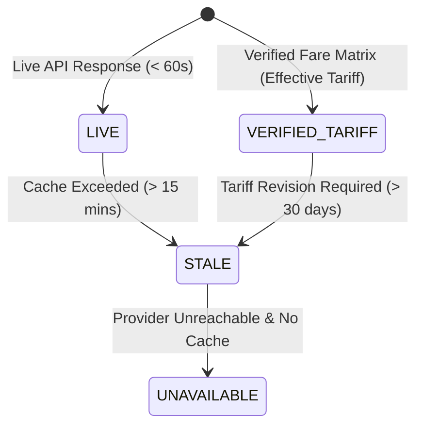

# Data Freshness & Cache Expiry Specification — Route Sense

## Overview

Route Sense implements normalized data freshness tagging to ensure commuters can distinguish between real-time provider responses, verified tariffs, and historical estimates.

---

## 1. Freshness Classifications

| Status Tag | Refresh Threshold | Description | Visual Badge |
|---|---|---|---|
| `LIVE` | $< 60\text{ seconds}$ | Direct live query response | Green Pulse Badge |
| `VERIFIED_TARIFF` | Tariff validity period | Government / operator published fare schedule | Blue Solid Badge |
| `STALE` | Exceeded cache ttl | Response older than permitted live window | Amber Badge |
| `UNAVAILABLE` | N/A | Data feed currently unavailable | Gray Badge |

---

## 2. Refresh Policies & Timezone

- **Default Timezone**: All journey timestamps are rendered in **Asia/Kolkata (IST)** (`UTC+5:30`).
- **Location Autocomplete Cache**: $24\text{ hours}$ for resolved place IDs.
- **Road Distance & Matrix Cache**: $1\text{ hour}$ for origin-destination pairs.
- **Fuel Price Feed**: Daily refresh at 06:00 AM IST.
