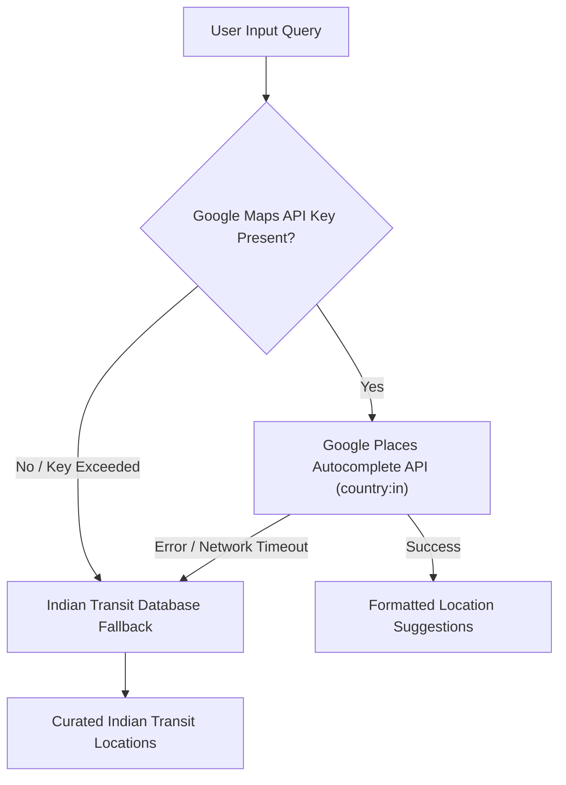

# Geospatial Location Search & Autocomplete — Route Sense

## Overview

Route Sense provides location search and autocomplete across all 28 States and 8 Union Territories in India. The location resolution module accepts diverse query types, including cities, localities, street addresses, railway stations, metro stations, bus terminals, airports, and major landmarks.

---

## 1. Provider Hierarchy & Fallback System

### 1.1 Google Places Integration
- **Endpoint**: `https://maps.googleapis.com/maps/api/place/autocomplete/json`
- **Filter**: `components=country:in` (Restricted to India geographical region).
- **Categories Mapped**:
  - `train_station`, `transit_station` $\rightarrow$ `railway_station`
  - `subway_station` $\rightarrow$ `metro_station`
  - `bus_station` $\rightarrow$ `bus_terminal`
  - `airport` $\rightarrow$ `airport`
  - `locality`, `sublocality` $\rightarrow$ `locality`
  - `tourist_attraction`, `point_of_interest` $\rightarrow$ `landmark`

### 1.2 Indian Transit Database Fallback (`src/lib/indianTransitDb.ts`)
Curated database containing key transit nodes and landmarks across Indian metropolitan hubs:
- **Mumbai Hub**: Dadar, CSMT, Bandra, Andheri, Kurla, Thane, Borivali, Churchgate.
- **Bengaluru Hub**: Majestic (KSR Bengaluru), Silk Board, Hebbal, Indiranagar, Whitefield, Electronic City, MG Road, Airport (KIA).
- **Delhi NCR Hub**: New Delhi Railway Station, Rajiv Chowk, Anand Vihar, Nizamuddin, Hauz Khas, Gurgaon Cyber City, Noida Sector 62.
- **Chennai Hub**: Chennai Central (MAS), Egmore, T. Nagar, Velachery, Guindy, Airport (MAA).
- **Kolkata Hub**: Howrah Junction, Sealdah, Esplanade, Salt Lake Sector V, Park Street.
- **Hyderabad Hub**: Secunderabad, Koti, Hitec City, Begumpet, Jubilee Hills.
- **Pune Hub**: Pune Junction, Swargate, Shivajinagar, Hinjewadi.

---

## 2. Validation & Stale Input Handling

1. **Selection Invalidation**: If a user modifies text after selecting an autocomplete suggestion, the stored coordinates are invalidated until a fresh item is clicked.
2. **Geographic Boundaries**: Latitudes bounded between $6.0^\circ\text{N}$ and $37.5^\circ\text{N}$; Longitudes bounded between $68.0^\circ\text{E}$ and $97.5^\circ\text{E}$.
3. **No Unverified Place Claims**: Unmatched raw text queries are resolved as city/area level approximations with explicit distance estimation badges.
