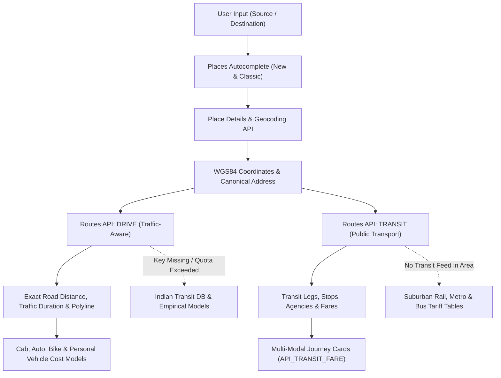

# Data Provider Integrations & API Adapters — Route Sense

## Overview

Route Sense integrates licensed and open data providers for location autocomplete, routing, public transit schedules, and fare data. The primary commercial geospatial partner is **Google Maps Platform**, backed by an extensive curated **Indian Transit Database** fallback covering all 28 States & 8 Union Territories in India.

---

## 1. Google Maps Platform Integration Architecture

---

## 2. Configured Google Maps APIs & Official Documentation References

| API / Service | Endpoint / Method | Purpose | Documentation Reference |
|---|---|---|---|
| **Places API (New)** | `POST https://places.googleapis.com/v1/places:autocomplete` | Real-time autocomplete suggestions bounded to India (`includedRegionCodes: ["in"]`) | [Places Autocomplete](https://developers.google.com/maps/documentation/places/web-service/place-autocomplete) |
| **Places API (Classic)** | `GET https://maps.googleapis.com/maps/api/place/autocomplete/json` | Backward-compatible fallback autocomplete | [Places Overview](https://developers.google.com/maps/documentation/places/web-service/overview) |
| **Place Details** | `GET https://places.googleapis.com/v1/places/{placeId}` & `place/details/json` | Canonical coordinates (`latitude`, `longitude`) & structured address components | [Place Details](https://developers.google.com/maps/documentation/places/web-service/place-details) |
| **Geocoding API** | `GET https://maps.googleapis.com/maps/api/geocode/json` | Fallback address and coordinate resolution across India | [Geocoding API](https://developers.google.com/maps/documentation/geocoding) |
| **Routes API (New)** | `POST https://routes.googleapis.com/directions/v2:computeRoutes` | Traffic-aware driving route calculation (`TRAFFIC_AWARE`) & route polyline | [Routes API](https://developers.google.com/maps/documentation/routes) |
| **Public-Transit Routes** | `POST https://routes.googleapis.com/directions/v2:computeRoutes` (`TRANSIT`) | Boarding/alighting stops, transit vehicle type, agency, and API transit fare (`fare`) | [Transit Routes](https://developers.google.com/maps/documentation/routes/transit-route) |
| **Route Matrix** | `POST https://routes.googleapis.com/distanceMatrix/v2:computeRouteMatrix` | Multi-node origin-destination distance/duration matrix | [Route Matrix](https://developers.google.com/maps/documentation/routes/compute_route_matrix) |
| **Maps JavaScript API**| SDK script load | Client-side map rendering & spatial controls | [Maps JavaScript API](https://developers.google.com/maps/documentation/javascript) |

---

## 3. Pricing & Fare Extraction Policy

1. **Google-Returned Transit Fares (`API_TRANSIT_FARE`)**:
   - When Google's Transit response includes fare data (`route.travelAdvisory.transitFare` or `route.fare`), Route Sense uses that exact figure and attaches the tag `API_TRANSIT_FARE`.
   - Currency is normalized to Indian Rupees (INR, ₹).

2. **Official Tariff Tables (`OFFICIAL_TARIFF`)**:
   - Google APIs do not index tariffs for every Indian transport agency (e.g. suburban unreserved tickets or state transport stage fares).
   - When a transit line is returned without fare metadata, Route Sense applies verified official tariffs based on distance slabs and passenger count.

3. **Road Aggregators & Personal Vehicles (`ESTIMATED_FARE` / `ESTIMATED_OPERATING_COST`)**:
   - Google Routes API provides the exact road distance in kilometres and traffic-aware duration in minutes.
   - These parameters feed directly into our mode-specific fare models (Uber/Ola/Rapido benchmark equations and fuel running cost calculations).

---

## 4. Credentials & Security

- **Server-Side Restriction**: Private API keys (`GOOGLE_MAPS_SERVER_API_KEY`) are accessed strictly within Next.js server route handlers (`src/app/api/`) and are never exposed in client bundles.
- **Client Browser Key**: If using client-side Maps JavaScript API, a separate browser key (`NEXT_PUBLIC_GOOGLE_MAPS_BROWSER_KEY`) restricted by HTTP referrer is configured in Google Cloud Console.
- **Billing & Quota Safeguards**: If no key is configured, or if API quotas are exhausted, the platform automatically switches to the Indian Transit Database and Haversine circuity engine with clear, transparent user disclosures.
