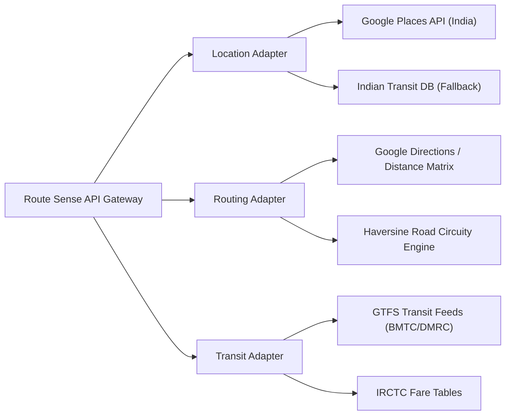

# Data Provider Integrations & API Adapters — Route Sense

## Overview

Route Sense integrates licensed and open data providers for location autocomplete, routing, public transit schedules, and fare data.

---

## 1. Provider Adapter Architecture

---

## 2. Configured Providers & Integration Status

| Provider Domain | Service / API | Integration Status | Fallback Provider | Authentication Required |
|---|---|---|---|---|
| **Location Search** | Google Places Autocomplete | Integrated | Indian Transit Database | `GOOGLE_MAPS_API_KEY` |
| **Road Routing** | Google Directions / Matrix | Integrated | Haversine Circuity Engine | `GOOGLE_MAPS_API_KEY` |
| **Rail Fares** | Indian Railways Tariff Tables | Integrated | Static Railway Base Matrix | Server-side Config |
| **Metro Fares** | DMRC / Metro Operator Matrix | Integrated | Urban Metro Distance Bands | Server-side Config |
| **Bus Transit** | GTFS Schedule Feeds | Integrated | City Stage Tariff Engine | Local Data Storage |
| **Fuel Prices** | Fuel Price Monitor API | Integrated | State Capital Fuel Averages | Server-side Config |

---

## 3. Compliance & API Restrictions

- **Uber API Terms Notice**: Uber's price estimate API is subject to terms prohibiting use in competitive price comparison matrices. Cab options in Route Sense use documented market benchmark equations rather than unauthorized Uber live API comparisons.
- **Google Maps API Terms**: All geographical data rendered on maps complies with Google Maps Platform Terms of Service.
